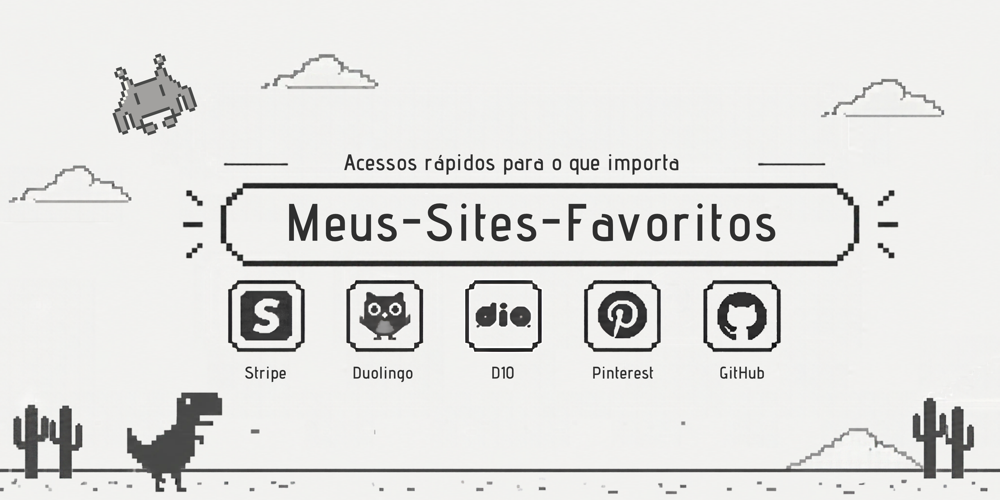

# 🌐 Meus Sites Favoritos

> Projeto prático desenvolvido para a **Agenda 12** da disciplina de **Desenvolvimento de Sistemas I**.

Uma página web responsiva criada com **HTML5** e **CSS3** para apresentar cinco sites favoritos, com imagem, título, breve descrição e link de acesso direto.

---

## 📌 Sobre o Projeto

O objetivo desta atividade é aplicar conceitos fundamentais de desenvolvimento front-end por meio da criação de uma página simples, organizada e responsiva.

A página apresenta uma seleção de cinco sites considerados referências nas áreas de tecnologia, aprendizado, design e produtividade. Cada card contém:

- Imagem de identificação do site;
- Título;
- Breve descrição;
- Link externo para acesso direto.

---

## 🚀 Tecnologias Utilizadas

| Tecnologia | Aplicação no projeto |
|---|---|
| **HTML5** | Estruturação semântica da página, utilizando tags como `<header>`, `<main>`, `<section>`, `<h1>`, `<a>` e `` |
| **CSS3** | Estilização visual, centralização do layout, responsividade e efeitos de interação com o usuário |
| **Git e GitHub** | Versionamento do código e publicação do repositório |

---

## 💻 Sites Selecionados

| Site | Descrição |
|---|---|
| **Stripe** | Plataforma de infraestrutura para pagamentos digitais e soluções financeiras |
| **Duolingo** | Aplicativo e plataforma voltados ao aprendizado de idiomas |
| **DIO (Digital Innovation One)** | Plataforma de cursos, trilhas e bootcamps na área de tecnologia |
| **Pinterest** | Rede social visual utilizada para descoberta de ideias, referências e inspirações |
| **GitHub** | Repositório com componentes e layouts de interface para projetos front-end |

---

## 🖥️ Como Visualizar

1. Faça o download ou clone este repositório:
   ```bash
   git clone https://github.com/seu-usuario/nome-do-repositorio.git
   ```
2. Abra o arquivo `index.html` em seu navegador.

---

## 👤 Autora

**Maria Vitória Moraes**  
Curso: Desenvolvimento de Sistemas I  
Atividade: Agenda 12  

---

## 📄 Licença

Este projeto foi desenvolvido para fins educacionais.  
O conteúdo pode ser utilizado como referência de estudo, desde que os devidos créditos sejam mantidos.
